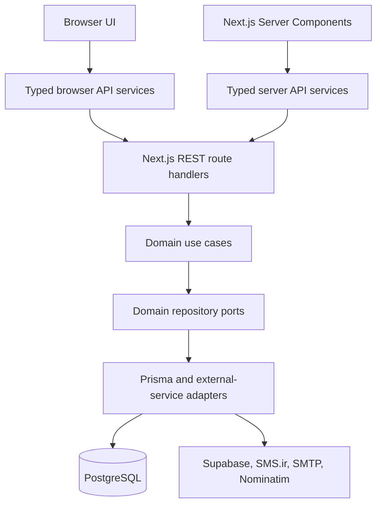
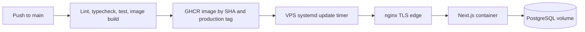

# FreshDrop Product and System Design

| Field | Value |
| --- | --- |
| Status | Living design specification |
| Version | 1.0 |
| Last updated | 2026-08-11 |
| Product | FreshDrop grocery-delivery storefront and operations dashboard |
| Owners | Product, Design, Engineering, and Operations |
| Review cadence | Review for every material product, architecture, security, or design-system change |

## 1. Purpose

This document is the design authority for FreshDrop. It describes the product experience, visual language, application architecture, data boundaries, operational model, and production acceptance criteria.

It is intentionally grounded in the current repository. Statements marked **current** describe implemented behavior. Statements using **must** define the standard that new work and production releases are required to meet.

When sources disagree, use this precedence order:

1. Domain invariants and security policy in code.
2. This document and accepted architecture decisions.
3. Design-system tokens and shared components.
4. Feature-level implementation.
5. Mockups and one-off examples.

## 2. Product definition

FreshDrop is a localized grocery-commerce platform with two connected experiences:

- A mobile-first storefront where customers discover products, manage a cart, choose a delivery location and slot, pay, and track orders.
- A responsive operations dashboard where authorized staff manage the catalog, inventory, fulfillment, customers, reviews, promotions, reporting, exports, notifications, settings, and team access.

### 2.1 Product goals

- Make a repeat grocery order fast, predictable, and understandable on a phone.
- Preserve trust by showing accurate availability, price, discounts, delivery commitments, payment state, and order history.
- Give operations staff an auditable workflow from catalog setup through fulfillment and reporting.
- Provide a first-class English/LTR and Persian/RTL experience from one product model.
- Keep business rules independent of Next.js, Prisma, and external providers.
- Remain deployable as a self-hosted service with a small operational footprint.

### 2.2 Non-goals

- A multi-vendor marketplace with vendor-specific settlement.
- Native iOS or Android applications.
- A public developer API with third-party credentials and versioned SLAs.
- A globally distributed, multi-region architecture at the current scale.
- Real-time courier dispatch until a real telematics and routing provider replaces the simulated adapter.

### 2.3 Primary actors

| Actor | Need | Main surfaces |
| --- | --- | --- |
| Visitor | Discover the catalog and understand the service | Home, category, search, product |
| Customer | Buy groceries and manage personal commerce data | Cart, checkout, orders, addresses, wallet, profile |
| Support | Read operational context and leave internal order notes | Dashboard, orders, customers, activity |
| Staff | Fulfill orders and communicate with customers | Orders, delivery issues, activity |
| Admin | Operate the catalog and commercial configuration | Products, categories, inventory, promotions, reviews, reports, settings |
| Owner | Control privileged access and store-wide governance | Team, role changes, settings, activity |

## 3. Experience principles

1. **Trust before speed.** Never hide the final payable amount, delivery commitment, stock outcome, or refund state to make a flow appear simpler.
2. **One clear next action.** Each transactional screen should have one visually dominant action; secondary actions must not compete with it.
3. **Progress is explicit.** Multi-step flows show current position, completed steps, validation state, and the consequence of leaving.
4. **The server owns durable truth.** Client state may make interaction immediate, but it must reconcile with server state after mutations.
5. **Errors are recoverable.** Explain what failed, preserve valid input, place field errors next to fields, and provide a safe retry or alternative.
6. **Localization is structural.** Direction, typography, icons, number formatting, currency, dates, and layout are locale-aware—not translated as an afterthought.
7. **Administrative data is evidence.** Dashboard metrics and reports must identify their time range, comparison period, units, filters, and source semantics.
8. **Accessibility is a release requirement.** Keyboard access, semantics, focus, contrast, reduced motion, and assistive-technology names are part of completion.

## 4. Information architecture

### 4.1 Storefront

The storefront is constrained to a focused mobile canvas (`max-w-md`) and uses four persistent primary destinations when the user is not in a focused task flow:

- Home
- Categories
- Cart
- Profile

Search, product detail, favorites, orders, wallet, settings, and support sit below those destinations. Checkout, address entry, payment entry, onboarding, and settings subflows hide the bottom navigation to reduce distraction and accidental exits.

### 4.2 Dashboard

The dashboard is a full-width responsive workspace. Navigation progressively adapts:

- Small screens: bottom navigation for primary tasks plus a drawer for the complete hierarchy.
- Medium desktop: persistent icon rail.
- Large desktop: expandable labeled sidebar with a persisted collapse preference.

Navigation visibility is permission-aware for discoverability, but routes and endpoints independently enforce authorization. Hidden navigation is never treated as a security control.

### 4.3 Core customer journey

At every transition, the UI must preserve the cart and make stock, price, discount, tax, delivery charge, delivery slot, and payment changes visible before confirmation.

## 5. Visual design system

### 5.1 Source of truth

Token definitions in [`src/presentation/design-system/tokens/`](src/presentation/design-system/tokens/) are authoritative. [`src/styles/tokens.css`](src/styles/tokens.css) is generated output and must not be edited manually.

New interface work must:

- Use semantic tokens instead of literal colors, shadows, radii, or font sizes.
- Reuse or extend shared components before creating feature-local primitives.
- Use Tailwind CSS v4 utilities and logical direction utilities (`ms`, `me`, `ps`, `pe`, `start`, `end`) where direction matters.
- Add a token only when it represents a reusable design decision, not to conceal a one-off value.
- Regenerate tokens with `npm run generate:tokens` and commit the generated CSS with the source change.

### 5.2 Color

| Role | Token | Current value | Usage |
| --- | --- | --- | --- |
| Brand / primary action | `primary` | `#11A94D` | Primary CTA, selected state, active navigation |
| Primary hover | `primary-hover` | `#0E893E` | Pointer hover feedback |
| Primary pressed | `primary-pressed` | `#0A682F` | Active/pressed feedback |
| Secondary brand | `secondary` | `#A9116D` | Controlled accent; never a competing primary CTA |
| Page background | `background` | `#FFFFFF` | Base canvas |
| Primary text | `foreground` | `#1E1E1E` | Body and heading content |
| Surface | `surface` | `#F9FAFB` | Cards, panels, and neutral wells |
| Recessed surface | `surface-sunken` | `#F0F2F5` | Nested or visually inset areas |
| Border | `border` | `#E4E4E4` | Structural boundaries |
| Focus ring | `ring` | `#51EE8F` | Keyboard focus indicator |
| Destructive | `destructive` | `#E0491A` | Destructive actions and critical failures |

Success, warning, info, and error tokens must communicate meaning with text or an icon as well as color. Chart colors are categorical, ordered, and sourced from the shared palette.

Color pairs must meet WCAG 2.2 AA contrast for their actual text size and weight. The existing muted foreground must not carry essential small text unless its contrast is verified against the rendered background.

### 5.3 Typography

- English/LTR uses Inter.
- Persian/RTL uses Vazirmatn, including Latin glyphs in mixed content.
- The locale layout loads both through `next/font`; RTL remaps the design-system font variable globally.
- Text must use semantic classes such as `text-heading-h2`, `text-body-b7`, or `text-button-btn2`.

| Family | Styles | Intended use |
| --- | --- | --- |
| Heading | H1 32/40, H2 24/28, H3 20/24, H4 20/24 | Page and section hierarchy |
| Body | 18/24, 16/24, 14/20, 12/16 variants | Content, metadata, labels, helper text |
| Button | 16/16, 14/14, 14/24, 16/24 | Interactive action labels |
| Label | 12/12, 10/10, 8/10 variants | Compact badges and supporting labels only |

Do not use the smallest label styles for long-form content, validation messages, or essential instructions. Text must tolerate localization expansion and user zoom to 200% without loss of content or function.

### 5.4 Shape, elevation, and spacing

- Controls use semantic `button` and `input` radii.
- Cards use the `card-md`, `card-lg`, or `card-xl` scale according to nesting and prominence.
- Pills are reserved for chips, compact statuses, and segmented selections.
- Elevation is intentionally minimal. The current shadow tokens are limited to sheets and map markers.
- Default control heights are 40, 44, and 48 pixels. Primary touch targets must provide at least a 44-by-44-pixel target or equivalent spacing.
- Spacing is mobile-first and should follow Tailwind's base scale. Repeated exceptions belong in a layout component or token.

### 5.5 Iconography and imagery

- Use Lucide through the shared `Icon` component so sizing and alignment remain consistent.
- Icon-only controls require an accessible name.
- Directional icons must mirror in RTL; symbolic icons such as search, help, favorite, and status must not.
- Product photography should use a consistent aspect ratio, neutral background, meaningful alternative text, responsive sizing, and a stable placeholder to prevent layout shift.
- Decorative images use empty alternative text. Operational images must never be the only carrier of state.

### 5.6 Components

The shared component layer currently includes buttons, form controls, data tables, menus, modals, sheets, popovers, tabs, chips, badges, selectable tiles, empty states, skeletons, charts, ratings, avatars, and thumbnails.

Every reusable component must define:

- Supported variants and sizes.
- Default, hover, active, focus-visible, disabled, loading, error, and selected states as applicable.
- Keyboard interaction and accessible name/description behavior.
- LTR and RTL behavior.
- Responsive behavior and overflow rules.
- Reduced-motion behavior.
- A stable public export from the design-system index.

Feature code must not recreate button, input, modal, sheet, tab, checkbox, badge, or table primitives.

## 6. Responsive behavior

FreshDrop is mobile-first.

| Range | Storefront | Dashboard |
| --- | --- | --- |
| Base / phone | Centered canvas up to 448px, bottom navigation, task-focused flows | Compact cards/tables, bottom navigation, drawer, simplified top bar |
| `sm` and above | Allow expanded labels and secondary metadata | Reveal secondary controls and denser comparisons |
| `lg` and above | Storefront remains intentionally narrow | Persistent 76px navigation rail and full workspace |
| `xl` and above | No change to core reading width | Optional 256px labeled sidebar |

Responsive rules:

- Never make primary content dependent on hover.
- Prefer reflow, card views, or explicit horizontal scrolling over clipped tables.
- Keep primary actions reachable without covering the final content; fixed navigation and sheets require matching content padding.
- Avoid layout shifts when data, images, fonts, or validation messages load.
- Test the narrowest supported viewport in both English and Persian.

## 7. Interaction, state, and feedback

### 7.1 Forms

- Labels remain visible or programmatically associated with fields.
- Required state is announced before submission.
- Client validation improves response time; the API repeats validation with the shared Zod contract.
- Field errors appear adjacent to the field and a submission summary is used when a long form has multiple failures.
- Valid user input survives recoverable failures.
- Submit controls expose loading with `aria-busy`, prevent duplicate submission, and retain an understandable label.
- Destructive actions state the affected object and require confirmation when reversal is difficult.

### 7.2 Loading

- Server Components should render initial durable data where possible.
- Skeletons should match final geometry and must not loop when reduced motion is requested.
- Background refresh must preserve usable content.
- A spinner is appropriate for a bounded action; it must not replace all context on a full page.

### 7.3 Empty, error, and success states

- Empty states explain why no data is present and offer the next useful action.
- Expected domain errors use actionable, localized language.
- Unexpected server-render failures use route error boundaries with retry.
- Success feedback is proportional: inline confirmation for local changes, toast/banner for cross-page effects, and a dedicated confirmation screen for order completion.
- A successful notification send is not the same as a successful order mutation; best-effort side effects must be reported and monitored independently.

### 7.4 Motion

Motion should clarify state change, not decorate routine navigation. Transform, position, size, slide, zoom, and looping animations must respect `prefers-reduced-motion`. Color transitions, fades, and busy spinners may remain when they preserve meaningful feedback.

## 8. Accessibility standard

FreshDrop targets WCAG 2.2 Level AA for customer and dashboard workflows.

Release-critical requirements:

- Complete keyboard operation with a visible, consistent focus ring.
- Logical focus order and focus restoration for dialogs, sheets, menus, and route changes.
- Correct landmarks, headings, lists, tables, labels, names, roles, and states.
- No information conveyed by color, position, motion, or icon alone.
- Text contrast of at least 4.5:1, large text at least 3:1, and meaningful non-text UI at least 3:1.
- Touch/pointer targets that meet WCAG target-size requirements or their spacing exceptions.
- Zoom and reflow at 200% without two-dimensional scrolling for ordinary content.
- Status messages announced without stealing focus.
- Form errors associated with inputs and understandable without placeholder text.
- Reduced-motion support and no time limit without a user-controlled extension.

Accessibility acceptance testing must cover current Chrome and Firefox keyboard use, VoiceOver/Safari or NVDA/Firefox, English LTR, Persian RTL, 200% zoom, and reduced motion.

## 9. Localization and commerce semantics

### 9.1 Locale and direction

The current locale set is `en` and `fa`. Locale is a persisted user preference stored in `NEXT_LOCALE`; public URLs remain locale-neutral and middleware rewrites internally to the locale segment.

- Set `lang` and `dir` at the document root.
- Use `next-intl` messages for all user-visible copy; do not embed English strings in components.
- Maintain complete key parity between [`messages/en.json`](messages/en.json) and [`messages/fa.json`](messages/fa.json).
- Format numbers, dates, relative time, units, and currency with locale-aware helpers.
- Use logical CSS properties and verify mixed-direction content such as phone numbers, order IDs, SKUs, and currency.
- Translation changes require contextual review, not only key parity.

### 9.2 Money

- PostgreSQL/Prisma `Decimal(12,2)` is the persisted source for prices, balances, totals, refunds, tax, and line snapshots.
- Never use binary floating-point for durable monetary calculation.
- Store purchase-time price, tax, delivery, discount, and exchange-rate facts needed to reproduce a receipt.
- Display USD in English and converted Toman in Persian according to current product behavior.
- The live USD-to-Toman provider may refresh the global display rate hourly; failures fall back to configured data and must be observable.
- A rate used to place an order must be snapshotted if settlement or later reconciliation depends on it.

## 10. Application architecture

FreshDrop uses Clean Architecture with a REST backend-for-frontend boundary.

### 10.1 Dependency rules

- `src/domain`: entities, use cases, repository ports, and domain errors; framework-free.
- `src/contracts`: Zod schemas shared across the route/client boundary.
- `src/infrastructure`: concrete persistence and provider adapters.
- `src/infrastructure/container.ts`: the sole composition root.
- `src/presentation`: feature UI, typed API wrappers, and the design system.
- `app`: routing, layouts, Server Component orchestration, and thin REST controllers.

Dependencies point inward. Domain code must never import Next.js, Prisma, Axios, React, or presentation code. Route handlers must not import presentation schemas.

### 10.2 Read flow

1. A Server Component calls a feature-specific server API service.
2. The server client resolves an absolute base URL and forwards request cookies.
3. A route handler authenticates as needed, validates parameters, and invokes one use case.
4. The use case operates through domain repository ports.
5. The route returns a validated resource envelope.
6. The Server Component passes plain serializable data to a presentational screen.

### 10.3 Mutation flow

1. A Client Component validates input and calls a typed browser API service.
2. The route authenticates, authorizes, revalidates, and invokes a use case.
3. Related durable writes commit in a single transaction where atomicity is required.
4. The client refreshes the route so server state is authoritative.
5. Best-effort notifications run after the durable business transaction and cannot roll it back.

Do not manually patch a durable client-side list after mutation unless a deliberately introduced query cache owns optimistic reconciliation.

### 10.4 API contract

- Base surface: `/api/*`.
- Success: the resource payload, or `204 No Content`.
- Failure: `{ error: { message, code?, fieldErrors? } }`.
- Validation: `400`; unauthenticated: `401`; forbidden: `403`; missing: `404`; conflict: `409`; unexpected: `5xx`.
- All external input is parsed and validated at the boundary.
- Browser and server failures normalize into a shared typed error shape.
- Breaking contract changes require an explicit migration plan; public versioning is unnecessary while this remains an internal BFF.

## 11. Domain and data design

### 11.1 Major domains

| Domain | Responsibilities |
| --- | --- |
| Identity and access | OTP sign-in, user profile, roles, permissions, ownership |
| Catalog | Products, categories, translations, images, pricing |
| Cart and checkout | Cart lines, promotions, tax, totals, address, slot reservation, payment |
| Fulfillment | Orders, items, status transitions, notes, delivery issues, drivers, tracking |
| Money | Wallet accounts, cards, transactions, refunds, receipt snapshots |
| Engagement | Favorites, reviews, stock alerts, customer notifications |
| Operations | Inventory movements, activity log, admin notifications, store settings |
| Intelligence | Analytics, reports, customer-segment snapshots, exports and schedules |

### 11.2 Required invariants

- Order numbers are unique and immutable.
- Order status changes follow domain-defined transitions and append an immutable status event.
- Delivery completion time is derived from the first completed status event, not a mutable row update time.
- Order items snapshot the purchased product identity, quantity, unit price, tax, and substitution/refund facts required for reconciliation.
- `total = subtotal + shipping - discount`; VAT is an inclusive portion of that total and is snapshotted separately with its rate.
- Wallet debits, stock changes, order transitions, return decisions, and refunds that form one business action commit atomically.
- Stock movements, role changes, and admin-visible mutations append audit evidence in the same transaction as the change where supported.
- Delivery-slot capacity is enforced transactionally; the UI's availability is advisory until booking commits.
- Customer-owned data is always scoped by authenticated user ID on the server.
- Internal order notes are never included in customer responses.

### 11.3 Persistence

PostgreSQL 17 is the system of record and Prisma 6 is the primary data adapter. Schema changes must use reviewed, forward-only migrations.

Production migration rules:

- Prefer expand/migrate/contract for changes that cannot tolerate downtime.
- Backfill in bounded batches and measure locks before production execution.
- Add indexes from measured query patterns; verify with realistic cardinality.
- Never reset production to resolve migration drift.
- Back up before risky migrations and test restore procedures on a schedule.
- Retention and deletion rules must cover user data, exports, audit records, notification logs, and orphaned media.

## 12. Authentication and authorization

### 12.1 Authentication

Auth.js v5 uses phone plus OTP through a credentials provider and JWT sessions. The domain verifies the OTP and creates the user idempotently on first sign-in.

Production requirements:

- `AUTH_SECRET` is a high-entropy secret stored outside source control.
- Mock OTP is forbidden in public production environments and startup must fail closed if production SMS configuration is absent.
- OTP issuance and verification require expiry, attempt limits, replay prevention, per-phone and per-IP rate limits, abuse monitoring, and generic responses that do not enumerate accounts.
- Session cookies must be Secure, HttpOnly, and appropriately SameSite in production.
- Sensitive authentication events must be auditable without logging OTP values or secrets.

### 12.2 Authorization

Authorization is permission-based. Current roles are customer, support, staff, admin, and owner. The policy is centralized in [`src/domain/entities/Permission.ts`](src/domain/entities/Permission.ts).

- Every protected page and API endpoint checks the specific permission required.
- Ownership and team-management actions require stricter checks than ordinary administration.
- Object-level authorization is mandatory for orders, addresses, wallet data, cards, reviews, exports, and profiles.
- Permission changes invalidate or re-evaluate active authorization promptly.
- The UI may hide unavailable actions but must handle a server-side `403` gracefully.

## 13. Security and privacy

FreshDrop must apply defense in depth.

- Validate and constrain every request body, query parameter, path parameter, uploaded file, and provider response.
- Enforce CSRF protection appropriate to cookie-authenticated mutation routes.
- Apply rate limits to authentication, search, geocoding, uploads, exports, and expensive analytics endpoints.
- Keep Prisma and provider credentials server-only; never expose Supabase service-role keys.
- Validate file signatures, size, dimensions, and allowed types; generate server-controlled paths; clean orphaned uploads safely.
- Use signed, short-lived URLs for private export files.
- Add a production Content Security Policy, HSTS, frame restrictions, MIME sniffing protection, and a conservative referrer policy at the edge.
- Encrypt transport with TLS and encrypt backups and sensitive provider credentials at rest.
- Redact phone numbers, addresses, tokens, cookies, payment details, and secrets from logs and error telemetry.
- Minimize collected personal data and document retention, deletion, access, and incident-response procedures.
- Run dependency, container, and secret scanning in CI; address critical findings before release.
- Maintain a threat model for account takeover, coupon abuse, inventory races, refund abuse, export leakage, IDOR, upload attacks, and administrative privilege escalation.

## 14. Reliability, performance, and observability

### 14.1 Service objectives

Initial production targets, to be refined from real traffic:

| Signal | Target |
| --- | --- |
| Storefront/API availability | 99.9% monthly, excluding announced maintenance |
| Read API latency | p95 under 500ms at the origin for ordinary indexed reads |
| Write API latency | p95 under 1s, excluding external notification delivery |
| Server error rate | Under 0.5% of requests over 15 minutes |
| Core Web Vitals | p75 LCP <= 2.5s, INP <= 200ms, CLS <= 0.1 |
| Recovery point objective | <= 24 hours until WAL-based recovery is implemented |
| Recovery time objective | <= 4 hours for the current single-VPS topology |

### 14.2 Performance design

- Render initial read data on the server and avoid browser fetch waterfalls.
- Paginate unbounded collections and exports; never load all operational history into a page.
- Aggregate analytics in PostgreSQL and add query-level integration tests.
- Optimize images and fonts, reserve media dimensions, and keep client bundles feature-scoped.
- Cache public, low-volatility reads with explicit invalidation and privacy-safe keys.
- Use timeouts, bounded retries with jitter, and circuit-breaking behavior for external providers.
- Move long-running exports, bulk imports, and notification fan-out to a durable worker/queue as load grows.

### 14.3 Observability

Production must provide:

- Structured JSON logs with timestamp, severity, environment, request ID, route, status, duration, and safe actor identifier.
- Correlation IDs propagated through route, use case, repository, and provider calls.
- Error tracking with source maps and release identifiers.
- Metrics for traffic, latency, errors, saturation, database pool, slow queries, OTP outcomes, checkout outcomes, payment/refund failures, stock conflicts, export jobs, and notification delivery.
- Health, readiness, and dependency-aware diagnostics that do not leak secrets.
- Alerts tied to user impact and runbooks, not raw noise.
- Auditable dashboards for business correctness as well as infrastructure health.

## 15. Deployment and operations

The current production topology is a Dockerized Next.js application and PostgreSQL database behind nginx on one VPS. CI builds and publishes immutable images to GHCR; a systemd timer pulls changed image digests and recreates services.

Operational requirements:

- Deploy immutable images identified by commit SHA; retain a tested rollback image.
- Run database migrations as a controlled release step, not concurrently from multiple app replicas.
- Separate liveness from readiness; readiness should fail when required dependencies make the app unable to serve safely.
- Automate encrypted database backups and regularly prove restoration.
- Monitor TLS renewal, disk, database growth, container restarts, image pulls, and migration outcomes.
- Document rollback when a migration is not backward compatible.
- Prefer a staging environment with production-like providers and sanitized data for release validation.
- The single VPS is an accepted availability constraint; moving the database off-host and adding redundant app instances is the next resilience step when the SLO or traffic requires it.

## 16. Testing and quality gates

Every pull request must pass:

1. Dependency installation from the lockfile.
2. Generated-token consistency.
3. ESLint.
4. TypeScript strict typecheck.
5. Unit and contract tests.
6. Integration tests for affected repositories and transactions.
7. Production build and container build.

Risk-based additions:

- End-to-end tests for sign-in, browse-to-checkout, slot-capacity conflicts, order fulfillment, returns/refunds, and role enforcement.
- Locale parity plus critical-flow snapshots in English/LTR and Persian/RTL.
- Automated accessibility checks plus manual keyboard and screen-reader review.
- Visual regression for design-system primitives and high-value screens.
- Migration tests against a production-like database snapshot.
- Load tests for checkout contention, analytics, imports, exports, and notification fan-out.
- Security tests for object-level authorization, rate limits, uploads, signed downloads, and permission escalation.

A green typecheck alone is not production verification. Release evidence must state exactly which gates ran and disclose unrelated failures or skipped suites.

## 17. Current implementation status and production gaps

| Area | Current state | Production decision |
| --- | --- | --- |
| Catalog, carts, orders, wallets, delivery slots, reviews | PostgreSQL/Prisma-backed | Maintain transaction and authorization tests |
| Money | Fixed-precision database decimals and purchase-time snapshots | Keep decimal arithmetic end to end; verify rate snapshot semantics |
| Delivery history | Immutable order-status event ledger | Preserve as reporting source of truth |
| Favorites | In-memory/mock repository | Replace with durable per-user storage before general availability |
| Courier tracking | Persisted order stage plus simulated courier movement | Label as demo or replace with telematics and routing providers before promising live tracking |
| Stock-alert delivery | Logging adapter | Replace with an operational channel and delivery telemetry |
| Push notifications | Logging adapter | Implement web push or remove the user promise |
| OTP | Real SMS.ir when configured; mock fallback exists | Fail closed against mock mode in production and add abuse controls |
| Email/SMS side effects | Best-effort provider adapters | Add delivery metrics, retry policy, and a durable outbox/queue for critical messages |
| Exports | Private storage with signed URLs | Enforce retention, access re-check, expiry, and job limits |
| Deployment | Single VPS with local PostgreSQL volume | Prove backups/restore and document the accepted availability ceiling |
| Observability | Not established as a complete platform capability | Add structured telemetry, alerts, dashboards, and runbooks before production sign-off |

No mock or logging adapter may silently back a customer-visible production claim.

## 18. Change governance

### 18.1 Architecture decision records

A new ADR is required when changing:

- Application boundaries or dependency direction.
- Authentication, authorization, money, inventory, or order-state semantics.
- Database technology, durable event model, or transaction boundary.
- Locale URL strategy, currency source, or supported locale set.
- Hosting topology, deployment strategy, or provider of record.
- Design-system primitives or accessibility baseline.

An ADR records context, decision, alternatives, consequences, migration, and rollback.

### 18.2 Definition of done

A feature is complete only when:

- Product behavior and edge cases have explicit acceptance criteria.
- Domain rules live in use cases/entities rather than UI or route handlers.
- Inputs and outputs are typed and runtime-validated at trust boundaries.
- Authorization and object ownership are enforced server-side.
- Durable multi-write operations are atomic and auditable.
- UI uses shared tokens/components and covers all interaction states.
- English/LTR and Persian/RTL are reviewed with realistic content.
- Accessibility, responsive behavior, error recovery, and reduced motion are verified.
- Unit, integration, and appropriate end-to-end tests pass.
- Metrics, logs, alerts, operational documentation, and rollback exist in proportion to risk.
- This document, API documentation, and user-facing copy are updated when behavior changes.

## 19. Repository references

- Product and local operation: [`README.md`](README.md)
- Engineering conventions: [`CLAUDE.md`](CLAUDE.md)
- Locale root and fonts: [`app/[locale]/layout.tsx`](app/%5Blocale%5D/layout.tsx)
- Locale routing: [`src/i18n/routing.ts`](src/i18n/routing.ts)
- Design tokens: [`src/presentation/design-system/tokens/`](src/presentation/design-system/tokens/)
- Shared components: [`src/presentation/design-system/`](src/presentation/design-system/)
- Authorization policy: [`src/domain/entities/Permission.ts`](src/domain/entities/Permission.ts)
- Composition root: [`src/infrastructure/container.ts`](src/infrastructure/container.ts)
- Database schema: [`prisma/schema.prisma`](prisma/schema.prisma)
- CI pipeline: [`.github/workflows/ci.yml`](.github/workflows/ci.yml)
- Runtime topology: [`docker-compose.yml`](docker-compose.yml)

---

This is a living specification. A production-readiness review must evaluate the deployed configuration and operational evidence, not only the intended design recorded here.
